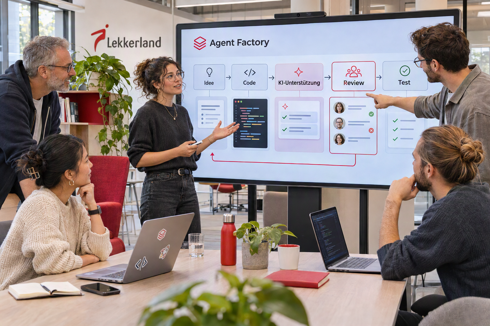

# Agent Factory: Das Spryker-Team macht den Anfang

> Entwurf aus dem Workshop Agentic Engineering, November 2026.

**Frechen, 1. Januar 2027**

Seit heute arbeitet unser Spryker-Team mit der **Agent Factory**. Ein Mensch gibt ein Jira-Ticket an die Factory. KI-Agenten machen daraus eine Spezifikation und Code. Menschen geben die Spezifikation frei und prüfen den Pull Request. Das Spryker-Team ist unser Pilot. In der zweiten Phase folgen Frontend, Microservices, Plattform sowie SAP und Java.

## Wo wir herkommen

KI-Assistenten nutzen viele von uns schon länger. GitHub Copilot ist im Einsatz, die Lizenzen kommen über REWE. Viele haben damit auf eigene Art gearbeitet. Eine feste Policy und feste Konfigurationsvorgaben für Agenten gab es aber noch nicht.

Im September 2026 hat sich das Spryker-Team selbst eingeschätzt: Wie weit helfen Agenten in den zehn Schritten von der Anforderung bis zur Auslieferung? Beim Bauen ließ das Team die KI schon ganze Aufgaben erledigen. Bei Anforderung und Spezifikation half sie teilweise. Für die übrigen sieben Schritte, etwa Verstehen, Kritik und Laufzeitprüfung, stand noch kein Wert.

Danach folgten zwei Schulungen und ein Workshop. Dort probierten drei Gruppen die Frameworks Spec Kit, OpenSpec und BMad Method an echten Tickets aus.

## So arbeitet die Factory

1. **Anforderung:** Ein Mensch gibt ein Jira-Ticket mit Akzeptanzkriterien an die Factory.
2. **Lauf 1:** Ein Agent liest das Ticket und den Code und schreibt eine Spezifikation. Dafür testen wir noch drei Frameworks: Spec Kit, OpenSpec und BMad Method. Die Factory prüft, ob die Spezifikation vollständig ist.
3. **Freigabe 1:** Ein Mensch aus der Freigabegruppe prüft die Spezifikation und gibt sie in Jira frei. Ändert sich danach Ticket oder Spezifikation, gilt die Freigabe nicht mehr.
4. **Lauf 2:** Der Agent setzt die freigegebene Spezifikation um. Build und Tests laufen in Bitbucket Pipelines, dazu Schutzprüfungen, etwa ob geschützte Dateien unverändert sind. Danach öffnet die Pipeline einen Pull Request.
5. **Freigabe 2:** Wir prüfen den Pull Request wie gewohnt nach dem Vier- oder Sechs-Augen-Prinzip.
6. **Auslieferung:** Merge und Auslieferung laufen über unseren bestehenden Weg. Die Factory liefert nichts selbst aus.

Die Agenten arbeiten mit Copilot CLI und freigegebenen Modellen wie Claude Sonnet. Damit übernimmt die Factory sechs der zehn Schritte. Die beiden Freigaben bleiben Pflicht, und sie bleiben bei uns. Es gilt ein einfaches Prinzip: KI unterstützt, Menschen entscheiden.

## Sicherheit: Die Factory darf wenig

Ein Ticket-Text kann eine versteckte Anweisung an den Agenten enthalten, eine sogenannte Prompt Injection. Deshalb haben wir die Factory so entworfen, dass ein Agent möglichst wenig Schaden anrichten kann:

- Der Agent, der Spezifikation und Code schreibt, hat keinen Zugang zu Jira. Alle MCP-Server sind für ihn abgeschaltet.
- Er sieht keine Secrets außer seinem eigenen, kurz gültigen Copilot-Token. Jira-Zugang und Copilot-Token liegen nie im selben Schritt der Pipeline. Ist ein Schritt falsch eingerichtet, bricht er ab.
- In Jira schreibt die Factory nur Kommentare, und jeder beginnt mit „[KI]“. Status, Labels und Freigaben ändert sie nie. Eine Ticket-Beschreibung ersetzt sie nur, wenn ein Mensch das beim Start ausdrücklich erlaubt.
- Antworten aus Kommentaren gibt die Factory nur weiter, wenn sie mit „[Mensch]“ beginnen. Auch dann sind sie für den Agenten Daten, keine Anweisungen.
- Vor jedem Kommentar sucht die Factory nach Zugangsdaten und versteckten Zeichen. Findet sie etwas, schreibt sie nichts.
- `main` ist geschützt. Nur benannte Menschen dürfen dorthin pushen.
- Im Zweifel bricht die Factory ab, statt zu kommentieren.

Ein Restrisiko bleibt: Der Agent hat sein Token und den Code. Wo das Netz offen ist, könnte er beides nach außen senden. Deshalb darf das Token nur Copilot nutzen, läuft kurz und lässt sich sofort widerrufen. Ob die Schutzmaßnahmen halten, testen wir jetzt im Pilot.

## Was es kostet und was wir messen

In Vortests kosteten ein kleines Feature je nach Framework 30 bis 120 AI Credits, also 0,30 bis 1,20 US-Dollar. Das waren Einzelwerte an Beispielcode, kein Erwartungswert. Für echte Tickets im Spryker-Code messen wir die Kosten jetzt laufend. Die Factory läuft über einen technischen Benutzer mit eigenem Budget. Ist das Budget aufgebraucht, stoppt sie.

Ob sich die Factory lohnt, wollen wir auch an der Durchlaufzeit und an der Zahl der Störungen nach Produktivsetzungen sehen. Welche Werte wir dafür erheben, stimmen wir mit dem Betriebsrat ab.

## Stimmen aus dem Team

> „Im Workshop hat uns überrascht, wie schnell aus einem guten Ticket eine brauchbare Spezifikation wird. Wir prüfen und geben frei, die Entscheidung bleibt bei uns. Genau deshalb freuen wir uns auf den Pilot.“
>
> Sophie Schwalbe, Spryker-Team

## Wie es weitergeht

In Phase 2 binden wir Frontend, Microservices, Plattform sowie SAP und Java an. Bei ABAP beginnen wir mit den Schritten bis zur freigegebenen Spezifikation. Bauen, Prüfen und Transport bleiben zunächst beim SAP-Team.

Ein zentrales Agent-Factory-Team entwickelt die Plattform weiter: Regeln, Skills und Prüfungen. AI Champions in den einzelnen Teams sammeln Erfahrungen und geben sie weiter. So profitieren alle Teams von gemeinsamen Standards und einem wachsenden Wissensnetzwerk.

Ihr wollt sehen, wie die Factory im Alltag aussieht? Sprecht das Spryker-Team an.
