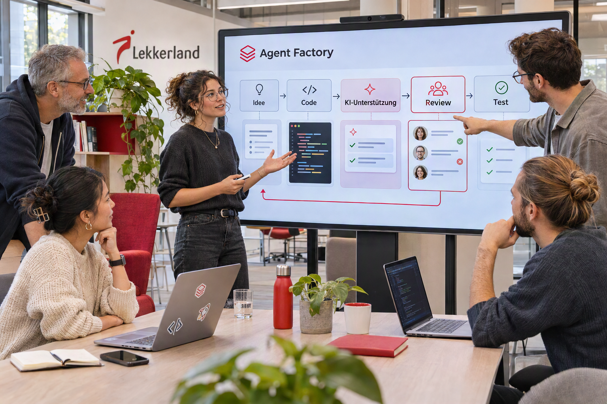

# Gemeinsam schneller zur besseren Software: Lekkerland etabliert die Agent Factory für KI-gestützte Entwicklung

**Frechen, 26. November 2026**

Künstliche Intelligenz wird bei Lekkerland zunehmend Teil des Arbeitsalltags. Damit alle Entwicklungsteams die Möglichkeiten von KI sicher, effizient und nach gemeinsamen Standards nutzen können, wurde die neue **Agent Factory** eingeführt.

Was vor einem Jahr noch aus vielen einzelnen Experimenten bestand, ist heute eine gemeinsame Plattform für alle Entwicklungsteams. Die Agent Factory bündelt Regeln, Best Practices, Skills und automatisierte Qualitätsprüfungen in einem einheitlichen Ansatz. So entsteht eine verlässliche Grundlage, um KI erfolgreich in der Softwareentwicklung einzusetzen.

## Mehr Zeit für Lösungen, weniger Zeit für Routine

Durch die Agent Factory können KI-Agenten wiederkehrende Aufgaben wie die Erstellung von Komponenten, Tests oder Refactorings übernehmen. Dadurch gewinnen Entwicklerinnen und Entwickler mehr Zeit für die eigentlichen Herausforderungen: Architekturentscheidungen, fachliche Lösungen und die Weiterentwicklung unserer Anwendungen.

Auch die Zusammenarbeit mit den Fachbereichen wird einfacher und schneller. Anforderungen werden klar beschrieben und können deutlich zügiger umgesetzt werden. Erste Ergebnisse stehen oft bereits innerhalb weniger Tage zur Verfügung.

## Qualität und Sicherheit im Mittelpunkt

Ein zentraler Erfolgsfaktor der Agent Factory ist die transparente und nachvollziehbare Qualitätssicherung. Jede Änderung durchläuft automatisierte Prüfungen und definierte Freigabeschritte. Besonders bei sicherheitsrelevanten oder umfangreichen Anpassungen bleiben menschliche Entscheidungen ein fester Bestandteil des Prozesses.

Dabei gilt ein einfaches Prinzip: KI unterstützt, Menschen entscheiden.

## Gemeinsame Standards für alle Teams

Begleitet wird die Einführung durch ein zentrales Agent-Factory-Team, das die Plattform kontinuierlich weiterentwickelt. Zusätzlich unterstützen AI Champions in den einzelnen Teams dabei, Erfahrungen auszutauschen und erfolgreiche Vorgehensweisen gemeinsam weiterzuentwickeln.

Auf diese Weise profitieren alle Teams von gemeinsamen Standards, einer hohen Qualität und einem stetig wachsenden Wissensnetzwerk.

## Erste Erfolge sichtbar

Die bisherigen Ergebnisse zeigen bereits das Potenzial des Ansatzes. Standardaufgaben können deutlich schneller umgesetzt werden, die Qualität der Ergebnisse bleibt hoch und neue Teams lassen sich in kurzer Zeit an die Plattform anbinden. Das zuletzt integrierte Team wurde am 14. September 2027 erfolgreich angeschlossen.

## Lernen statt Experimentieren

Eine wichtige Erkenntnis aus den vergangenen Monaten: Die größte Herausforderung lag nicht in der Einführung der KI selbst, sondern in ihrer verlässlichen und nachvollziehbaren Nutzung. Deshalb setzt Lekkerland heute auf klare Leitplanken, gemeinsame Regeln und konsequente Qualitätsprüfungen.

Die Agent Factory schafft damit die Grundlage, KI dauerhaft und verantwortungsvoll in die Softwareentwicklung zu integrieren und die Digitalisierung von Lekkerland weiter zu beschleunigen.
