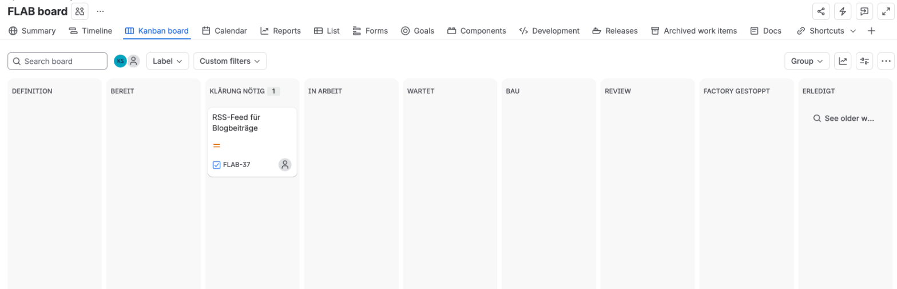
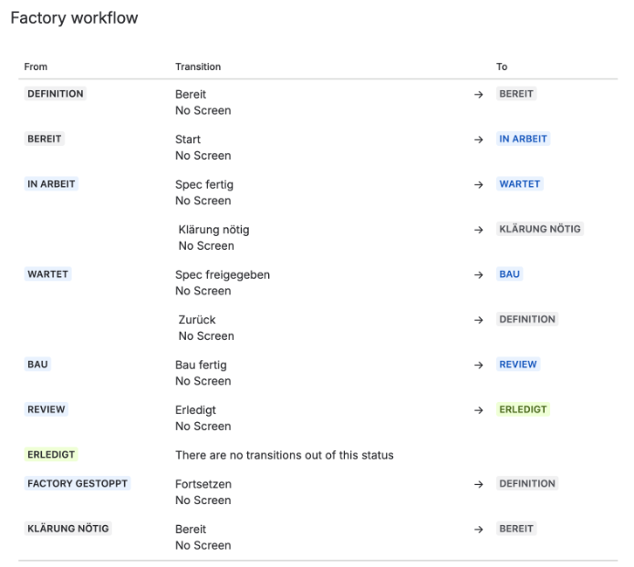
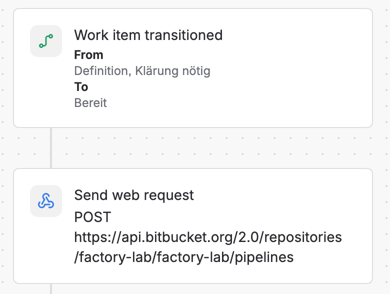
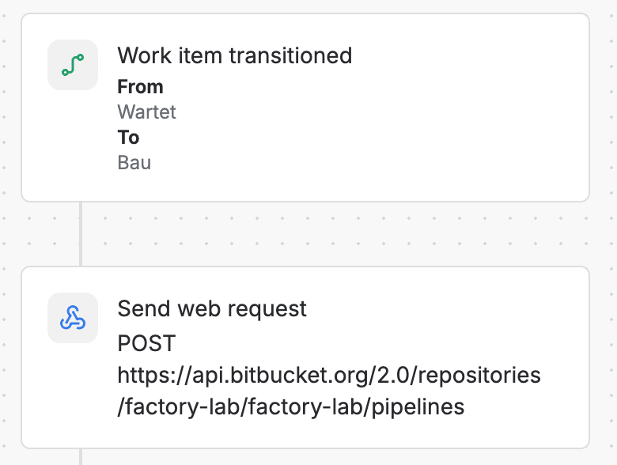

# Walkthrough: Die Agent Factory im Lab

Tag 2, 24. November 2026. Dieses Dokument führt euch durch die Agent Factory im Lab von atra. Ihr braucht dafür kein Konto: Fast alles ist öffentlich lesbar. Wo ein Login nötig ist, zeigt ein Bild, wie es aussieht.

Das Lab arbeitet mit [`symfony/demo`](https://github.com/symfony/demo), einem kleinen PHP-Blog, nicht mit eurem Code. Eure eigene Factory richtet ihr später in eurem Bitbucket ein: [Einrichtung](../../02-agent-factory/einrichtung/README.md).

Stand: 23. November 2026.

## Die Bausteine auf einen Blick

| Baustein | Wo | Ohne Login sichtbar |
|---|---|---|
| Jira-Space „Factory Lab Public“ (FLAB) | Ticket-Seiten, z. B. [FLAB-22](https://betterprojectsfaster.atlassian.net/browse/FLAB-22) | Ja |
| Kanban-Board | [FLAB board](https://betterprojectsfaster.atlassian.net/jira/software/c/projects/FLAB/boards/3) | Nein. [Bild](#so-sieht-es-in-jira-aus) |
| Jira-Workflow und zwei Automation-Regeln | Space-Einstellungen | Nein. [Bilder](#so-sieht-es-in-jira-aus) |
| Bitbucket-Repository `factory-lab/factory-lab`, Start-Branch `factory-base` | [Quellcode](https://bitbucket.org/factory-lab/factory-lab/src/factory-base/) | Ja |
| Pipeline-Definition | [`bitbucket-pipelines.yml`](https://bitbucket.org/factory-lab/factory-lab/src/factory-base/bitbucket-pipelines.yml) | Ja |
| Die Skripte der Factory | [`factory/`](https://bitbucket.org/factory-lab/factory-lab/src/factory-base/factory/), mit [README](https://bitbucket.org/factory-lab/factory-lab/src/factory-base/factory/README.md) | Ja |
| Die Läufe | [Pipelines](https://bitbucket.org/factory-lab/factory-lab/pipelines) | Ja |
| Die Ergebnisse | [Pull Requests](https://bitbucket.org/factory-lab/factory-lab/pull-requests/) | Ja |
| Das Image mit Copilot CLI und den drei Frameworks | [Docker Hub, `joedata/factory-lab`](https://hub.docker.com/r/joedata/factory-lab) | Ja |
| Deployment-Variablen mit den Tokens | Repository-Einstellungen | Nein, und das ist Absicht |

Die Factory nutzt Copilot CLI mit dem Modell Claude Sonnet 5.5. Spec Kit, OpenSpec und BMad liegen fertig im Image. Welches Framework ein Lauf nutzt, bestimmt das Label am Ticket.

### So sieht es in Jira aus

Das Board mit der neuen Spalte „Klärung nötig“:



Der Workflow. „Start“, „Spec fertig“, „Klärung nötig“ und „Bau fertig“ löst nur `factory-bot` aus. Den Notaus „Factory stoppen“ gibt es aus jedem Status; diese Ansicht zeigt ihn nicht.



Die zwei Automation-Flows. Jeder startet bei einem Statuswechsel einen Lauf in Bitbucket Pipelines. Das Start-Token steht in einem versteckten Header.

| Flow 1: Spec starten | Flow 2: Bau starten |
|---|---|
|  |  |

## Der Ablauf an einem echten Ticket: FLAB-22

FLAB-22 „Current year in the page footer“ lief am 23. November mit OpenSpec durch die Factory. Öffnet die Links nebeneinander und folgt dem Ticket.

| Schritt | Status in Jira | Wer | Was passiert | Wo ihr es seht |
|---|---|---|---|---|
| 1 | Definition | Mensch | Ticket mit Akzeptanzkriterien und genau einem Label, hier `sdd-openspec` | [FLAB-22](https://betterprojectsfaster.atlassian.net/browse/FLAB-22) |
| 2 | Bereit | Mensch | Das Ticket auf „Bereit“ setzen. Eine Jira-Automation startet die Pipeline `factory-spec` | [Bild: Flow 1](bilder/flow-spec-starten.png) |
| 3 | Bereit | Factory | Lauf 1: Copilot schreibt die Spec mit OpenSpec. Die Factory prüft sie | [Pipelines](https://bitbucket.org/factory-lab/factory-lab/pipelines) |
| 4 | In Arbeit, dann Wartet | `factory-bot` | Die Spec steht als Kommentar `FACTORY-SPEC v1` am Ticket und auf dem Branch `factory/FLAB-22` | Kommentar in [FLAB-22](https://betterprojectsfaster.atlassian.net/browse/FLAB-22) |
| 5 | Bau | Mensch | **Freigabe 1:** Ein Mensch aus der Freigabegruppe setzt „Spec freigegeben“. Die zweite Automation startet `factory-build`. Lauf 2: Copilot setzt die Spec um, die Tests laufen | [Lauf #85](https://bitbucket.org/factory-lab/factory-lab/pipelines/results/85). Im Lab gibt nur Karsten frei |
| 6 | Review | `factory-bot` | Die Factory öffnet einen Pull Request und verlinkt ihn am Ticket | [Pull Request #19](https://bitbucket.org/factory-lab/factory-lab/pull-requests/19) |
| 7 | Erledigt | Mensch | **Freigabe 2:** Ein Mensch prüft den Pull Request und führt ihn zusammen. Die Factory führt nie selbst zusammen | Pull Request #19 |

FLAB-22 lief vor der neuen Bereitschaftsprüfung. Heute prüft die Factory in Schritt 3 zuerst, ob das Ticket bereit ist: [Ist das Ticket bereit?](#neu-ist-das-ticket-bereit)

Dieselbe Strecke mit den anderen Frameworks:

- Spec Kit: [FLAB-18](https://betterprojectsfaster.atlassian.net/browse/FLAB-18), [Pull Request #13](https://bitbucket.org/factory-lab/factory-lab/pull-requests/13). Das Ticket hat zwei Spec-Kommentare, weil es zweimal lief.
- BMad: [FLAB-19](https://betterprojectsfaster.atlassian.net/browse/FLAB-19), [Pull Request #15](https://bitbucket.org/factory-lab/factory-lab/pull-requests/15). Das Ticket hat zwei Framework-Labels, weil es vor der Regel „genau ein Label“ lief. Heute stoppt so ein Ticket.

## Was in einem Lauf passiert

Jeder Lauf besteht aus mehreren Schritten. Jeder Schritt sieht nur die Secrets, die er braucht.

**`factory-spec`, Lauf 1:**

1. **Guard und Vorbereitung:** Stimmen Ticket-Schlüssel, Status und Label? Ist die Factory gestoppt? Dann holt die Factory das Ticket aus Jira.
2. **Agent:** Copilot CLI prüft zuerst, ob das Ticket bereit ist. Nur dann schreibt es die Spec mit dem gewählten Framework. Dieser Schritt sieht nur den Copilot-Token. Copilot läuft als eigener Benutzer ohne Rechte, und nur ein Patch verlässt den Schritt.
3. **Prüfung, ohne Secrets:** Hat der Agent nur Spec-Dateien geändert? Stecken Token-Muster oder unsichtbare Zeichen im Patch?
4. **Veröffentlichen:** Die Factory prüft alles noch einmal, pusht den Branch, kommentiert die Spec und setzt den Status.

**`factory-build`, Lauf 2:**

1. **Guard:** Die Factory prüft Freigabe 1. Hat eine Freigabe-Person freigegeben, und zwar nach dem Spec-Kommentar? Hat sich danach etwas geändert? Ist der Branch noch genau auf dem freigegebenen Stand?
2. **Agent:** Copilot setzt die Spec um und führt die Tests aus.
3. **Prüfung:** Hat der Agent geschützte Dateien geändert?
4. **Build und Tests, ohne Secrets:** frischer Checkout, `composer install`, Testbefehl.
5. **Veröffentlichen:** Branch pushen, Build-Status setzen, Pull Request öffnen.

Geschützt sind unter anderem die Pipeline-Definition, `factory/`, `AGENTS.md`, `.github/`, die Ordner der Frameworks, `composer.json` und `composer.lock`, `bin/`, die PHPUnit- und PHPStan-Konfiguration und `.env*`. Der Agent kann also keine neuen Pakete einbauen. Die vollständige Liste steht unter `protected_paths` in [`factory/config.json`](https://bitbucket.org/factory-lab/factory-lab/src/factory-base/factory/config.json).

## Die Prüfpunkte

### Neu: Ist das Ticket bereit?

Bevor die Factory eine Spec schreibt, prüft sie das Ticket. Ein eigener Copilot-Aufruf liest Ticket und Code und urteilt: bereit oder nicht bereit.

- **Bereit:** Lauf 1 geht weiter wie oben. Der Spec-Kommentar nennt die bestandene Prüfung.
- **Nicht bereit:** Die Factory schreibt keine Spec, keinen Code und keinen Branch. `factory-bot` kommentiert `FACTORY-NOT-READY v1` mit Gründen und Fragen und setzt das Ticket auf den neuen Status „Klärung nötig“.

Nicht bereit ist ein Ticket, wenn mindestens eines von sechs Kriterien zutrifft:

| ID | Nicht bereit, wenn … |
|---|---|
| `missing_detail` | Ziel, betroffene Seite oder erwartetes Ergebnis unklar sind |
| `untestable` | ein Akzeptanzkriterium in keinem Test scheitern kann |
| `already_exists` | der Code schon tut, was das Ticket verlangt |
| `contradicts_code` | das Ticket bestehendem Code widerspricht, ohne zu sagen, dass das gewollt ist |
| `protected_paths` | das Ticket Änderungen an geschützten Dateien braucht, etwa neue Pakete |
| `too_big` | das Ticket nicht in einen Pull Request passt |

Steht ein Ticket in „Klärung nötig“, beantwortet ihr die Fragen in der Beschreibung und setzt es wieder auf „Bereit“. Das startet einen neuen Lauf mit einer neuen Prüfung.

Zwei Beispiele aus dem Lab:

- [FLAB-31](https://betterprojectsfaster.atlassian.net/browse/FLAB-31) „Suche findet Beiträge auch über den Autornamen“: Die erste Fassung wollte nur eine „bessere Suche“. Die Prüfung lehnte ab (`missing_detail`, `untestable`) und nannte die drei Stellen im Code, an denen gesucht wird. Die zweite Fassung widersprach einem bestehenden Test (`contradicts_code`). Die dritte bestand die Prüfung und lief durch bis zum [Pull Request #26](https://bitbucket.org/factory-lab/factory-lab/pull-requests/26).
- [FLAB-37](https://betterprojectsfaster.atlassian.net/browse/FLAB-37) „RSS-Feed für Blogbeiträge“: Den Feed gibt es schon. Die Prüfung lehnte ab (`already_exists`) und nannte Route, Template und den bestehenden Test.

Die Kriterien stehen in einer einzigen Datei: [`factory/readiness.md`](https://bitbucket.org/factory-lab/factory-lab/src/factory-base/factory/readiness.md). Ihr passt sie an euer Team an: [So passt ihr die Kriterien an](../../02-agent-factory/bedienung/ticket-bereitschaft.md#so-passt-ihr-die-kriterien-an).

### Freigabe 1: Die Spec

Nur benannte Personen können „Spec freigegeben“ setzen. Im Lab ist das Karsten. Die Freigabe gilt nur für genau die Spec im Kommentar. Ändert jemand danach Beschreibung, Labels oder Kommentare, bricht der Bau ab.

Passt die Spec nicht, geht das Ticket mit „Zurück“ nach „Definition“. Ihr überarbeitet es und startet neu.

### Freigabe 2: Der Pull Request

Ihr lest den Diff wie bei jedem Pull Request. Die Fragen dazu:

- Decken die Tests jedes Akzeptanzkriterium ab?
- Hat der Agent etwas geändert, das das Ticket nicht verlangt?
- Würdet ihr den Code von einem Kollegen so annehmen?

## Wenn die Factory stoppt

Die Factory stoppt lieber, als etwas Falsches zu schreiben. Ihr seht drei Arten:

| Art | Beispiel | Was ihr tut |
|---|---|---|
| Kommentar `FACTORY-STOP v1`: Der Lauf passt nicht, etwa falscher Status oder kein Label | [FLAB-21](https://betterprojectsfaster.atlassian.net/browse/FLAB-21): „no framework chosen“ | Den Grund beheben, Ticket wieder auf „Bereit“ |
| Kommentar `FACTORY-NOT-READY v1`: Die Bereitschaftsprüfung lehnt das Ticket ab. Es geht nach „Klärung nötig“ | siehe [Ist das Ticket bereit?](#neu-ist-das-ticket-bereit) | Die Fragen in der Beschreibung beantworten, Ticket wieder auf „Bereit“ |
| Kommentar `FACTORY-QUESTIONS v1`: Das Framework findet das Ticket zu vage für eine Spec. Es geht nach „Klärung nötig“ | [FLAB-6](https://betterprojectsfaster.atlassian.net/browse/FLAB-6): „Make the blog better“, damals noch zurück nach „Definition“ | Die Fragen in der Beschreibung beantworten, Ticket wieder auf „Bereit“ |
| Kein Kommentar | – | Das Protokoll unter [Pipelines](https://bitbucket.org/factory-lab/factory-lab/pipelines) lesen |

**Notaus:** Jede Person kann ein Ticket auf „Factory gestoppt“ setzen. Jeder Lauf zu diesem Ticket bricht dann ab, beim Start und vor jedem Schreiben. Weiter geht es nur mit „Fortsetzen“ durch eine Freigabe-Person.

## Kosten und Dauer im Lab

Gemessen im Lab mit `symfony/demo`, je Ticket. Das sind Einzelwerte aus wenigen Läufen, keine Erwartung für euren Code. 1 AI Credit kostet 0,01 US-Dollar.

| | OpenSpec | Spec Kit | BMad |
|---|---|---|---|
| Lauf 1, Spec | 12 bis 21 Credits | 42 Credits | 26 Credits |
| Lauf 2, Bau | 12 bis 27 Credits | 34 Credits | 63 Credits |
| **Je Ticket** | **etwa 25 bis 50 Credits** | **etwa 76 Credits** | **etwa 89 Credits** |

- Die Bereitschaftsprüfung kostete 6 bis 11 Credits und dauerte 12 bis 60 Sekunden. Sie stoppt bei 40 Credits.
- Ein zu vages Ticket kostete 4 Credits und 42 Sekunden, bis die Fragen des Frameworks am Ticket standen.
- Lauf 1 dauerte 75 bis 147 Sekunden, Lauf 2 115 bis 211 Sekunden. Dazu kommen Wartezeit und die Zeit bis zur Freigabe.
- Jeder Copilot-Aufruf stoppt bei 150 Credits.
- Läufe warten aufeinander. „Queued“ in Bitbucket heißt warten, nicht neu starten.

## Selbst ausprobieren

### Ohne Konto

Öffnet die Links oben: Ticket, Pipeline-Lauf, Pull Request. Im Protokoll eines Laufs seht ihr jeden Schritt, auch den Copilot-Aufruf mit seinen Optionen.

### Mit Konto

Der Zugang ist für eure DevOps-Ansprechperson gedacht. Damit legt sie Tickets in FLAB an, setzt Labels und schiebt Tickets auf „Bereit“. Spec freigeben und zusammenführen kann im Lab nur Karsten. Die Status „In Arbeit“, „Wartet“, „Klärung nötig“ und „Review“ setzt nur `factory-bot`.

So schreibt ihr ein Ticket:

```text
Ziel
Wer will was und warum, in einem Satz.

Akzeptanzkriterien
- Wenn …, dann … (je Kriterium ein Satz, prüfbar durch einen Test)

Nicht Teil des Tickets
- Was der Agent nicht ändern soll.

Hinweise
- Betroffene Seite oder Route, z. B. Artikelseite /blog/posts/{slug}.
```

- Genau ein Label: `sdd-openspec`, `sdd-speckit` oder `sdd-bmad`.
- Klein: ein Pull Request, etwa eine Stunde Arbeit für einen Menschen.
- Prüfbar: Jedes Kriterium kann in einem Test scheitern.
- Vollständig: Während eines Laufs fragt der Agent nicht nach. Was nicht im Ticket steht, rät er.
- **Öffentlich:** FLAB und das Repository sind öffentlich. Keine internen Anforderungen, Namen oder Daten.

### Lokal, ohne Pipeline

Dieselben Copilot-Aufrufe wie die Factory startet ihr auch im Terminal, in eurem eigenen Repository: mit `local.py`. Prompts, Werkzeuge und Optionen kommen aus derselben `factory/config.json`, die Kriterien aus derselben `readiness.md`. Ein Test stellt sicher, dass beide Wege dieselben Aufrufe machen.

```bash
python3 tools/factory-lokal/local.py assess --ticket-file ~/factory-tickets/LL-123.json               # nur die Bereitschaftsprüfung
python3 tools/factory-lokal/local.py spec   --ticket-file ~/factory-tickets/LL-123.json --print-only  # nur die Copilot-Befehle zeigen
python3 tools/factory-lokal/local.py spec   --ticket-file ~/factory-tickets/LL-123.json               # Prüfung, dann Spec
python3 tools/factory-lokal/local.py build  --ticket-file ~/factory-tickets/LL-123.json               # Code nach der Spec, mit euren Tests
```

- **Das Ticket** holt ein eigener Copilot-Aufruf über euren Jira-MCP-Server in eine Datei. Ein API-Token braucht ihr dafür nicht.
- **Euer Testbefehl,** etwa `make test`, kommt in `local.json` unter `test_command`.
- **Anders als in der Factory:** kein Kommentar und kein Status in Jira, keine Freigabe zwischen Spec und Bau, keine Prüfung der geänderten Dateien. Den Diff prüft ihr selbst.
- **`--print-only`** zeigt die Befehle, die DevOps später in Bitbucket Pipelines übernimmt.
- **Im Lab** kostete OpenSpec etwa 27 Credits für die Spec und 17 für den Bau, je etwa eine Minute. Windows ist nicht getestet.

Einrichten und alle Befehle: [Factory-Schritte lokal ausführen](../../02-agent-factory/bedienung/lokal-ausfuehren.md).

### Ein Ticket schreiben lassen

Der Copilot-Skill `ticket-schreiben` macht aus einer Absicht ein oder mehrere Tickets:

```text
/ticket-schreiben Leser sollen sehen, wie lange sie für einen Artikel brauchen.
```

1. **Erst der Code:** Der Skill liest Code und Modul-Doku. Gibt es das schon? Widerspricht es dem Code? Auf Wunsch liest er auch eure Domänen in Confluence; das ist noch nicht getestet.
2. **Dann das Framework:** Es fragt nach, mit Spec Kit (`specify` und `clarify`), OpenSpec (`explore`) oder BMad (`forge-idea`).
3. **Zu groß?** Dann schlägt er ein Epic mit mehreren Tickets vor.
4. **Die Prüfung der Factory:** Jeder Entwurf geht durch dieselbe Bereitschaftsprüfung wie im Spec-Lauf.
5. **Euer „Ja“:** Ihr seht Annahmen, Prüfergebnis und den vollen Text. Erst dann legt der Skill die Tickets in Jira an, im Status „Definition“ und mit dem Label des Frameworks. Über den Jira-MCP-Server braucht ihr kein API-Token.
6. **Aufräumen:** Die Dateien, die das Framework beim Nachfragen anlegt, löscht der Skill wieder.

Im Lab kostete ein Ticket 29 bis 43 Credits und 4 bis 5 Minuten. Bei der Absicht „RSS-Feed“ fand der Skill den Feed schon im Code, bevor das Framework die erste Frage stellte. Der Skill ist freiwillig: Die Factory startet erst bei „Bereit“.

Einrichten und Ablauf: [Tickets mit dem Skill schreiben](../../02-agent-factory/bedienung/ticket-skill.md).

## Für eure eigene Factory

- [Überblick](../../02-agent-factory/ueberblick.md): eure zehn Schritte in der Factory.
- [Einrichtung](../../02-agent-factory/einrichtung/README.md): Bitbucket, Jira und Copilot, Schritt für Schritt.
- [Merkblatt](../../02-agent-factory/bedienung/merkblatt.md): die Bedienung auf einer Seite.

Was das Lab nicht zeigt und ihr mit eurem DevOps-Team klärt:

- Euer Testbefehl läuft in Docker, etwa `make test`. In Bitbucket Pipelines braucht der Testschritt dann Docker.
- Tokens: ein technischer GitHub-Benutzer mit Copilot-Lizenz, ein Jira-Konto und ein Bitbucket-Zugang für die Factory.
- Login im Browser reicht der Pipeline nicht. Ihr nutzt Jira, Confluence und vielleicht Bitbucket über einen Login im Browser. Die Pipeline braucht aber API-Tokens oder einen Service-Account. Prüft zuerst, ob eure Atlassian-Organisation API-Tokens erlaubt.
- Runner: Atlassians Cloud-Runner oder eigene Runner. Das Lab nutzt einen eigenen Runner, um Build-Minuten zu sparen.
