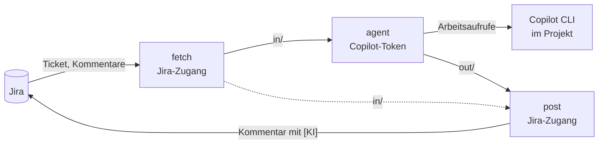

# Aufbau der Vorlage: Ziel, Design, Leitplanken

Hier steht der Aufbau von `agentic-factory.py` und die Gründe dafür. Bedienung: [README](README.md). Änderungen zu `local.py`: [`aenderungen.md`](aenderungen.md).

- **Stand:** 25. November 2026, Copilot CLI 1.0.115.
- **Quelle der Fakten:** der Code in diesem Ordner. `modul.funktion` nennt eine Stelle im Code, etwa `copilot.copilot_argv` für `copilot_argv` in `agentic_factory/copilot.py`.

## Ziel

**Für wen.** Entwicklerinnen und Entwickler in euren Teams, im eigenen Repo, mit jedem Stack. Sie starten das Skript auf ihrem Rechner. `clarify` und `assess` laufen auch in einer Pipeline.

**Wofür.** Vom Jira-Ticket zu Spec und Code, mit einem SDD-Framework: OpenSpec, Spec Kit oder BMad. Copilot CLI arbeitet allein, ohne Rückfragen (`-p`, `--no-ask-user`). Die Copilot-Aufrufe sind im Kern die der Pipeline-Factory: Prompts und Flags wie `agent.py` in factory-base, Abweichungen in `aenderungen.md`. Die Pipeline-Factory hat zwei Läufe und zwei Freigaben, siehe [Überblick](../../ueberblick.md). Ihren Schutz hat die Vorlage nicht: keinen eigenen Benutzer, keinen Container, keinen Prüfschritt.

**Ein Mensch bleibt dabei.** Jedes Ergebnis kommt als Kommentar ins Ticket, mit `[KI]` am Anfang. Menschen antworten mit `[Mensch]` am Anfang. Der nächste Lauf liest beides: `clarify` die Antworten auf seine Fragen, `spec` und `build` das Feedback zu Spec und Code. Jeden Lauf startet ein Mensch. Ein `[KI]`-Kommentar ist nie eine Freigabe. Das sagt auch der Kommentar zu einer Spec.

**Was sie bewusst nicht tut:**

- Keine Status-Übergänge, Labels, Branches oder Pull Requests. In Jira schreibt das Skript nur Kommentare, bei `clarify --apply` auch die Beschreibung.
- Kein Push durch Copilots Werkzeuge: `shell(git push:*)` steht in `deny_tools`. Das Skript committet nie selbst. Code, den der Agent startet, läuft aber mit eurer Anmeldung und könnte pushen.
- `build` und `init` nur lokal (siehe „Secrets getrennt“ unter [Leitplanken](#leitplanken-und-hooks)).
- Keine Prüfung des Diffs auf geschützte Pfade, Secrets oder unsichtbare Zeichen wie im Prüfschritt der Pipeline. Das Skript warnt nur. `git diff` lest ihr selbst.
- Keine Grenze für Runden der Überarbeitung. Die Credit-Grenze gilt je Aufruf.

## Design

### Die Modi

| Modus | Copilot-Aufrufe | Ergebnis in `out/` | Kommentar im Ticket |
|---|---|---|---|
| `init` | Einer, nur lesen. Mit `--apply` keiner | – | Keiner. `--apply` schreibt das geprüfte Ergebnis des letzten Laufs in `config.json` und `readiness.md` |
| `assess` | Die Bereitschaftsprüfung | `assessment.json` | Nur bei „nicht bereit“: `[KI] agentic-factory assess` |
| `clarify` | Der Klär-Aufruf. Bei „bereit“ dazu die Bereitschaftsprüfung auf die neue Beschreibung | `clarify.json`, `description.md` | Eine Runde, ein Vorschlag, „bereit“ oder die Übergabe an einen Menschen |
| `spec` | Die Bereitschaftsprüfung, wenn `assess.enabled` gilt. Dann ein Aufruf je Prompt in `spec_prompts`. Überarbeitung: ein Aufruf mit `revise_prompt` oder keiner | `spec.json` oder `spec-questions.md` | Die Spec, ihre Überarbeitung oder Fragen |
| `build` | Ein Aufruf je Prompt in `build_prompts`. Überarbeitung mit neuen Kommentaren: zuerst ein Aufruf mit `amend_prompt` | `build.json` | Der Build oder seine Überarbeitung |

Hat eine Überarbeitung keine neuen Kommentare und keine Änderung von Hand, schreibt der Agent-Schritt nur `nothing-new.json`. Er startet keinen Aufruf.

Das Ticket folgt direkt auf den Modus: als Schlüssel (`spec LL-123`) oder als Jira-URL (`spec https://example.atlassian.net/browse/LL-123`, auch mit `?selectedIssue=LL-123`). `ticket.key_from_arg` holt den Schlüssel heraus. Der Host der URL muss zu `jira_site` oder `JIRA_BASE_URL` passen, sonst stoppt das Skript vor jedem Aufruf. Lange Form: `--key LL-123`. `init` nimmt kein Ticket.

### Drei Schritte: `fetch`, `agent`, `post`

Jeder Lauf außer `init` hat drei Schritte. Sie tauschen Daten über einen Ordner mit `in/` und `out/` aus:



- **`fetch`** leert `out/`. Dann liest es Ticket und Kommentare über den Jira-Weg und schreibt nach `in/`: `request.json` (Modus, Key, Weg, Optionen und `me`, das Konto des Laufs), `ticket.json` und `comments.json`.
- **`agent`** liest nur `in/`, ohne Jira-Zugang. Er startet die Copilot-Aufrufe im Projekt und schreibt ihre rohen Ergebnisse nach `out/`.
- **`post`** traut `out/` nicht. Er prüft `in/` noch einmal, leitet daraus neu ab, was der Lauf ist, und vergleicht `out/` damit. Erst dann baut, scannt und postet er den Kommentar.

**Lokal** (`--step all`, der Standard) laufen alle drei in einem Prozess. Der Ordner heißt dann `io/` und liegt im Protokoll-Ordner.

**In einer Pipeline** läuft jeder Schritt in einem eigenen Container und bekommt nur sein Secret:

| Schritt | Secret | Deployment in `pipelines.example.yml` |
|---|---|---|
| `fetch` | `JIRA_BASE_URL`, `JIRA_API_TOKEN`, für Jira Cloud `JIRA_EMAIL` | `agentic-jira` |
| `agent` | `COPILOT_GITHUB_TOKEN` | `agentic-agent` |
| `post` | wie `fetch` | `agentic-post` |

Sieht `fetch` oder `post` das Copilot-Token oder `agent` das Jira-Token, stoppt das Skript (`fetch.step_checks`). Der Ordner heißt dort `agentic-io/`. Bitbucket reicht `in/` und `out/` als Artefakte weiter.

### Drei Wege zu Jira

| Weg | Wann | Wie |
|---|---|---|
| `mcp` | Standard außerhalb einer Pipeline. Nur Jira Cloud | Euer Atlassian-MCP-Server in Copilot. Jede Jira-Aktion ist ein eigener, kurzer Copilot-Aufruf mit genau einem Werkzeug: `getJiraIssue`, `addCommentToJiraIssue`, `editJiraIssue` oder `atlassianUserInfo`. Er läuft in einem Ordner unter `~/.factory-local/`, außerhalb des Projekts. Der Lese-Aufruf sieht das ganze Ticket, mit allen Kommentaren und Autoren |
| `api` | Standard in einer Pipeline | REST mit `JIRA_BASE_URL` und `JIRA_API_TOKEN`. Mit `JIRA_EMAIL`: Basic Auth für Jira Cloud. Ohne: Bearer-Token für Jira Data Center. Das Skript liest selbst, ohne Copilot |
| offline | Mit `--ticket-file`, optional dazu `--comments-file` | Kein Jira. Das Skript postet nichts und schreibt den Kommentar nach `out/comment-1.txt` |

Die Arbeitsaufrufe haben auf keinem Weg Jira-Werkzeuge. Das Skript nimmt ihnen die drei Jira-Variablen und schaltet alle MCP-Server ab. Sie sehen nur die Kommentare mit `[KI]` oder `[Mensch]`, ohne Autor.

### Der Stand: Kommentare und Kopien auf eurem Rechner

Das Skript hat keine eigene Datenbank. Den Stand eines Tickets liest es jedes Mal aus den Kommentaren. Dazu kommen die Kopien der Spec auf dem Rechner des Laufs:

- **`[KI]`-Kommentare** beginnen mit einem Marker, etwa `[KI] agentic-factory klärung runde=2 key=LL-123`, `[KI] agentic-factory spec key=LL-123` oder `[KI] agentic-factory build überarbeitung=3 key=LL-123`. Alle Marker: `clarify.MARKERS`.
- **Zeilen darin** tragen den Stand weiter: `Change: <name>.`, `Bearbeitet: Kommentar <ids>.`, `Start-Commit: <sha>` und `Spec-Prüfsumme: <sha256>`. `feedback.state` liest sie.
- **`[Mensch]`-Kommentare** sind Antworten und Feedback. Sie kommen als eigener Block in den Prompt, als Daten.
- **Als Ergebnis zählen nur `[KI]`-Kommentare** vom Konto des Laufs, und nur unbearbeitete. Mehr: [Welche Kommentare zählen](README.md#welche-kommentare-zählen).
- **Die Kopien der Spec** unter `~/.factory-local/<repo>/specs/` auf diesem Rechner sind die Basis für den Diff eurer Änderungen von Hand. Bei BMad zeigen sie auch, welcher PRD-Ordner zur Spec gehört. Die Kommentare tragen nur die Prüfsumme, nicht diese Basis.

Fehlen die Kopien, etwa auf einem anderen Rechner oder nach dem Löschen:

- Vor dem ersten Build postet `spec` die ganze Spec ohne Diff.
- Nach dem ersten Build stoppt `build`, sobald jemand die Spec von Hand geändert hat.
- Bei BMad kennt das Skript den PRD-Ordner nicht mehr.

Startet deshalb Überarbeitungen nach dem ersten Build und jede Überarbeitung mit BMad auf dem Rechner des vorigen Laufs ([Die Kopien der Spec](README.md#die-kopien-der-spec)). Sonst bleibt `--fresh`.

**Die Phasen des Feedbacks.** Die Spec-Phase läuft bis zum ersten `[KI]`-Kommentar von `build`, der zählt. Bis dahin gehen neue `[Mensch]`-Kommentare und Änderungen von Hand an `spec`. Danach, in der Build-Phase, gehen sie an `build`, und `spec` lehnt ab. `build` schreibt dann erst neue Aufgaben in die Spec, dann den Code. Bei OpenSpec passt es auch Proposal, Specs und Design an. Bei Spec Kit und BMad stehen die Änderungen nur in den Aufgaben. Spec und Plan zeigen dann einen älteren Stand als der Code. `--fresh` startet einen Modus neu. Schritt für Schritt: [Feedback zu Spec und Build](README.md#feedback-zu-spec-und-build).

### Ablage außerhalb des Projekts: `~/.factory-local/<repo>/`

| Pfad | Was drin steht |
|---|---|
| `<zeit>-<modus>-<key>/` | Ein Ordner pro Lauf: Ticket-Text, Kommentare, Befehle, Antworten des Modells. Je Arbeitsaufruf `events-<aufruf>.jsonl` und `usage-<aufruf>.json`. Bei `--step all` `io/` mit `in/` und `out/`. Je Jira-Aufruf über MCP ein Ordner `jira-<n>-<werkzeug>/` mit `af-expect.json`, `events.jsonl`, `usage.json` und, wenn der Hook lief, `hook.log`. Bei `init`: `<zeit>-init-INIT/` mit `init-result.json` für `init --apply` |
| `blocked.jsonl` | Was Copilot in allen Läufen abgelehnt hat, mit geschwärzten Tokens, siehe [Blockierte Aufrufe](README.md#blockierte-aufrufe-blockedjsonl) |
| `specs/<key>/<change>/<modus>-<n>/` | Kopie der Spec-Dateien nach jedem Lauf von `spec` und `build`, für den Diff ([oben](#der-stand-kommentare-und-kopien-auf-eurem-rechner)) |

Dazu kommt der leere Ordner `~/.factory-local/no-hooks/` für die `git`-Aufrufe des Skripts. Alles bleibt, bis ihr es löscht ([wie](README.md#die-dateien)). `<repo>` ist der Name des Projektordners, auch mit Leerzeichen und Umlauten. Einen leeren Namen, `.`, `..`, Schrägstriche und Steuerzeichen lehnt das Skript vor dem ersten Aufruf ab (`snapshot.repo_part`).

Warum außerhalb: Ein Jira-Aufruf in einem Ordner des Projekts würde dessen `.github/` laden. Liegt der Protokoll-Ordner doch im Projekt, stoppt das Skript (`fetch.Run.log`). Die Kopien der Spec legt `snapshot.save` nur unter `~/.factory-local/` ab.

## Leitplanken und Hooks

Die Tabelle geht von außen nach innen: was Copilot darf, was das Skript nach jedem Aufruf prüft, was es vor dem Posten prüft.

| Leitplanke | Was sie verhindert | Wo im Code | Grenzen |
|---|---|---|---|
| Freigaben je Framework | Der Agent startet nur, was `spec_tools` oder `build_tools` des Frameworks nennen, plus die Datei-Werkzeuge `read` und `write`. Alles andere lehnt Copilot ab | `config.json` (`frameworks.<fw>`), `copilot.plan`, `copilot.copilot_argv` (`--allow-tool=…`) | Eine Freigabe passt auf den Anfang eines Befehls. BMad darf mehr ([unten](#was-nicht-geschützt-ist)) |
| `read_tools` | In `spec` und `build` sind nur lesende Befehle frei, etwa `ls`, `cat`, `grep`. `find`, `sed`, `awk` und `git` fehlen mit Absicht: Sie können schreiben oder Befehle starten. Stopp bei einem Eintrag ohne `shell(…)` oder einem Treffer in `deny_tools` | `copilot.check_read_tools`. `copilot.plan`, `copilot.revise_plan`, `copilot.amend_plan` hängen sie an | `cat` und `grep` lesen auch außerhalb des Projekts ([unten](#was-nicht-geschützt-ist)) |
| Abgeleitete Test-Freigabe | Der Build startet nur den ganzen Testbefehl: aus `./run-tests` wird `shell(./run-tests:*)`. Der Befehl hat ein Wort, bei `npm`, `yarn` und `go` zwei. Längere Freigaben passen in Copilot CLI 1.0.115 nie. Dann stoppt `build` vor dem Aufruf | `copilot.test_tool`, `copilot.check_test_rule`, `copilot.build_test_command`, `copilot.plan` | `:*` erlaubt angehängte Argumente. Ein Testskript, das sie ignoriert, nimmt sie dem Agenten. Tests führen Code des Agenten aus ([unten](#was-nicht-geschützt-ist)) |
| `deny_tools` | Verbietet `git push`, `git remote`, `git config`, `curl`, `wget`, `ssh`, `scp`, `env`, `printenv`, `npm install`, `npm i`, `npm ci`, `npm exec` und `npx`. Ein Verbot gilt vor jeder Freigabe | `config.json`, `copilot.copilot_argv` (`--deny-tool=…`), `copilot.denied_by` | Passt auch nur auf den Anfang. Andere Paketmanager verbietet die Vorlage nicht. `init` kann Verbote vorschlagen |
| `forbidden_flags` | Kein Aufruf mit `--allow-all`, `--allow-all-tools`, `--allow-all-paths`, `--allow-all-urls`, `--yolo`, `--assisted-approval`, `--trust-folder`, `--add-dir` oder `--no-custom-instructions`. Das letzte schaltet `AGENTS.md` ab. Darum verbietet das Skript es auch, wenn eine alte `config.json` es nicht nennt. Es prüft jedes Wort des Befehls, auch `copilot` aus `local.json` | `copilot.copilot_argv`, `copilot.NO_INSTRUCTIONS` | Nur die genannten Flags |
| `forbidden_env` und feste Umgebung | Stopp, wenn eure Umgebung `COPILOT_ALLOW_ALL` oder `COPILOT_ASSISTED_APPROVAL` enthält oder `SPECKIT_COPILOT_ALLOW_ALL_TOOLS=1`. Das Skript setzt `COPILOT_AUTO_UPDATE=false`, `SPECKIT_COPILOT_ALLOW_ALL_TOOLS=0`, `DO_NOT_TRACK=1`, `OPENSPEC_TELEMETRY=0`. Es entfernt `JIRA_BASE_URL`, `JIRA_EMAIL` und `JIRA_API_TOKEN` | `copilot.child_env`, `copied.SAFE_ENV`, `copilot.JIRA_ENV` | Copilot bekommt alle anderen Variablen eurer Shell, auch Tokens für Cloud oder Datenbank |
| Credit- und Zeitgrenze | Kein endloser Aufruf: 150 Credits je Arbeitsaufruf, 40 für Bereitschaftsprüfung, `clarify` und `init`, 30 je Jira-Aufruf. 1200 Sekunden je Arbeitsaufruf, 300 je Jira-Aufruf | `copilot.copilot_argv` (`--max-ai-credits`), `copilot.run_call`, `config.json` (`max_ai_credits`, `agent_timeout_s`), `jira_mcp.JIRA_CALL_CREDITS`, `jira_mcp.JIRA_CALL_TIMEOUT` | Je Aufruf, nicht je Lauf |
| `--deny-tool=shell` und `shell_ran` | Aufrufe ohne Shell-Werkzeug bekommen `--deny-tool=shell`: Bereitschaftsprüfung, `clarify`, `init`, Jira-Aufrufe. Sonst startet Copilot 1.0.115 Shell-Befehle, die es für lesend hält. Lief trotzdem einer: Stopp, kein Post | `copilot.copilot_argv`, `copilot.has_shell_tool`, `copilot.shell_ran`, `agent.Work.call`. Bei Jira-Aufrufen: `jira_mcp.check_jira_call` | Nicht in `spec` und `build`: Dort würde das Verbot auch alle `shell(…)`-Freigaben abschalten. Copilot kann dort lesende Befehle ohne Freigabe ausführen |
| MCP-Server aus | `--disable-builtin-mcps`, dazu `--disable-mcp-server=<name>` für jeden Server aus `copilot mcp list --json`: eure, die des Projekts, die von Plugins. Ein Jira-Aufruf lässt nur euren Jira-Server an | `copilot.mcp_servers`, `agent.Work`, `jira_mcp.jira_call_argv` | Klappt die Liste nicht: Stopp. Das Skript liest nur die Namen der Server |
| `init` liest nur | Ein Aufruf nur mit dem Datei-Werkzeug `read`: kein Schreiben, keine Shell, keine MCP-Server. Er antwortet mit JSON. Ändert er eine Datei oder committet er: Stopp, kein Vorschlag | `init.FILE_TOOLS`, `init.init_call`, `init._run_init_call` | Die Kontrolle danach sieht nur, was `git status` zeigt |
| `init` lehnt ab und fügt nur hinzu | Ein Vorschlag lockert nichts. Was das Skript ablehnt: [unter der Tabelle](#was-init-ablehnt) | `init.refusal`, `init.check_suggestions`, `init._deny_problem`, `init.apply` | Angenommene `add_tools` erweitern die Freigaben trotzdem. Breite Freigaben wie `shell(make:*)` markiert der Bericht nur |
| `init --apply` schreibt, was ihr gelesen habt | `init` speichert das geprüfte Ergebnis mit Prüfsummen von `config.json` und `readiness.md`. `--apply` schreibt es ohne neuen Aufruf | `init.run_init`, `init.latest_result`, `init._apply_saved` | Haben sich die Dateien seitdem geändert: Stopp. Startet dann `init` noch einmal |
| Schreib-Bereich je Aufruf | Die Bereitschaftsprüfung darf nur `FACTORY-ASSESSMENT.json` ändern, `clarify` nur `FACTORY-CLARIFY.json`, der amend-Aufruf nur seine Dateien (OpenSpec: den Change-Ordner, Spec Kit: `tasks.md`, BMad: `SPEC.md`). Keiner dieser drei darf committen. Eine Spec muss genau einen Change schreiben, eine Überarbeitung keinen zweiten. Sonst Stopp | `agent._run_calls`, `agent._clarify_calls`, `agent._amend_done`, `feedback.amend_paths`, `fetch.spec_result`, `revise.revise_out` | Sieht nur, was `git status` zeigt |
| Geschützte Pfade zwischen den Aufrufen | Ändert ein Aufruf von `spec` oder `build` eine Datei unter `protected_paths` oder eine von `AGENTS.md` verlinkte Datei, auch per Commit: Stopp vor dem nächsten Aufruf. Ebenso, wenn `copilot instruction list --json` danach andere Dateien nennt. Sonst folgt der nächste Aufruf geänderten Anweisungen oder baut auf der Änderung auf | `agent._stop_on_protected`, `copilot.protected_hits`, `copilot.agents_links`, `copilot.linked_hits`, `agent._run_calls` | Sieht nur, was `git status` und die Commits seit dem Start zeigen |
| Warnungen nach dem Lauf | `WARNING: protected paths changed …`, wenn sich im letzten Aufruf eine Datei unter `protected_paths` geändert hat, auch in Commits des Agenten. Bei `spec` auch für Dateien außerhalb des Spec-Ordners | `copilot.snapshot`, `copilot.changed_paths`, `copilot.warnings_for`, `agent._run_calls` | Nur eine Warnung, erst nach dem Lauf. Ein `Makefile` nur, wenn ihr es in `protected_paths` aufnehmt |
| Anweisungs-Dateien | Vor jedem Lauf nennt das Skript die Dateien, die Copilot als Anweisungen lädt, etwa `AGENTS.md`. Fehlt `AGENTS.md`, sagt es das. Es warnt, wenn Copilot Dateien von außerhalb des Projekts lädt, etwa aus `~/.copilot/` | `copilot.instruction_sources`, `copilot.instruction_notes`, `agent.Work` | Nur eine Warnung. Es warnt auch, wenn `copilot instruction list --json` nicht klappt |
| Scans vor dem Posten | Kein Kommentar mit Token, Secret, unsichtbaren Zeichen oder fremden Links. Details: [unter der Tabelle](#was-die-scans-finden) | `checks.post_findings`, `copied.token_findings`, `copied.invisible_findings`, `post.verdict_tokens`, `revise.checked`, `post.checked_build` | Findet nur bekannte Token-Formate und die Werte der Secrets. Ein Datenbank-Passwort in einer Spec geht durch |
| Prüfung jedes Jira-Aufrufs | Nach jedem Aufruf über MCP prüft das Skript die Ereignisse von Copilot: nur das erwartete Werkzeug (und `tool_search_tool`), genau einmal, das richtige Ticket, die richtige `cloudId`, nur die erwarteten Argumente, der Text Zeichen für Zeichen. Dann liest es den gespeicherten Kommentar oder die Beschreibung zurück | `jira_mcp.check_jira_call`, `jira_mcp.JiraMcp.run`, `jira_mcp.JiraMcp.add_comment`, `jira_mcp.readback_matches` | Merkt Fehler erst hinterher. Ein falscher Kommentar steht dann schon in Jira. Die Meldung nennt ihn, ihr löscht ihn von Hand |
| Der Guard-Hook | `guard.py` lässt nur `tool_search_tool` und den einen erwarteten Jira-Aufruf durch, siehe [Der Hook und was ihn ersetzt](#der-hook-und-was-ihn-ersetzt) | `hooks/guard.py` (`check`, `args_problem`). `jira_mcp.jira_call_argv` lädt ihn per `--plugin-dir`. Fehlt `guard.py`, stoppt `fetch.Run.jira` den Weg `mcp` | Copilot 1.0.115 führt ihn nicht aus. Dann zählt die Prüfung danach |
| Vertrauen in `[KI]`-Kommentare | Als Ergebnis zählt nur ein unbearbeiteter Kommentar vom Konto des Laufs. Sonst Stopp, mit Hinweis auf `--fresh` | `feedback.state`, `feedback.trust`, `revise.decide`, `fetch.proposal_trust` | Offline prüft es nur, ob ein Kommentar bearbeitet ist. Mehr [unter der Tabelle](#vertrauen-in-ki-kommentare) |
| `me`: das Konto des Laufs | `fetch` fragt das Konto (`api`: `GET /myself`, `mcp`: `atlassianUserInfo`) und schreibt es nach `in/request.json`. So urteilt `agent` ohne Jira-Zugang wie `post`. `post` fragt noch einmal. Bei einem anderen Konto: Stopp | `fetch.account_of`, `fetch.read_in`, `revise.verify_me` | Nur bei `spec` und `build`, und nur wenn die Kommentare ein Ergebnis oder Antworten haben. Offline gibt es kein `me` |
| `post` leitet neu ab | Siehe [oben](#drei-schritte-fetch-agent-post). Was `post` vergleicht: [unter der Tabelle](#was-post-vergleicht) | `post.outcome`, `post.checked_build`, `revise.checked`, `revise.checked_nothing_new`, `post.clarify_outcome`, `agent.Work.call` (`fetch.folder_digest`) | Diff, Prüfsumme, „von Hand geändert“ und der `Start-Commit` des ersten Builds kommen aus dem lokalen Repo. Bei ihnen prüft `post` nur die Form |
| Pfade der Spec-Kopie | Das Skript liest und kopiert Spec-Dateien nur als echte Dateien im Repo: kein absoluter Pfad, kein `..`, kein symbolischer Link im Pfad | `snapshot._inside`, `snapshot._part`, `snapshot.repo_part`, `snapshot.save`, `snapshot.spec_files`, `fetch.spec_result` | Gilt für Prüfsumme, Kopie und Text jeder Spec, auch der ersten. Einen symbolischen Link im Spec-Ordner lässt das Skript weg |
| Prüfung des Testbefehls | Stopp bei: Zeichen der Shell, Anführungszeichen, einer Variablen davor, Code im Befehl (`bash -c`, `python3 -c`, `node -e`), einem Befehl ohne festes Ziel, Wrapper-Optionen ohne `--opt=value`, einem Treffer in `deny_tools` | `copilot.check_test_command`, `copilot.build_test_command` | Fängt Fehler in der Konfiguration. Keine Sicherheitsgrenze |
| `git` ohne Code aus dem Repo | Jeder `git`-Aufruf des Skripts läuft mit `core.fsmonitor=false`, `core.hooksPath=~/.factory-local/no-hooks`, `diff.external=` und `core.pager=cat`, `git diff` dazu mit `--no-ext-diff --no-textconv`. Vor jedem `git`-Aufruf und nach jedem Copilot-Aufruf vergleicht das Skript `.git/config`, `config.worktree`, die Hooks und eingebundene Dateien mit dem Stand beim Start. Bei einer Änderung: Stopp vor dem nächsten `git`-Befehl | `ticket.git_argv`, `ticket.git_dir_files`, `ticket.check_git_dir`, `ticket.trust_git_dir`, `agent.Work.call` | Zusätzlicher Schutz, keine Grenze. Bindet `.git/config` eine Datei im Projekt ein: Stopp schon vor dem ersten Aufruf |
| Ereignisse wie erwartet | Das Skript warnt, wenn `session.start` fehlt, ein Aufruf ohne erkannte Ereignisse endet oder Copilot eine andere Version als 1.0.115 meldet. Denn `blocked.jsonl`, die Shell-Prüfung und die Testzeile lesen diese Ereignisse | `copilot.event_warnings`, `copilot.non_json_tail`, `agent.Work.call`, `agent.Work.report` | Nur eine Warnung |
| Secrets getrennt | In einer Pipeline sieht jeder Schritt nur sein Secret ([oben](#drei-schritte-fetch-agent-post)). Dort lehnt das Skript auch `--step all`, den Weg `mcp`, `build` und `init` ab | `fetch.step_checks`, `config.choose_route`, `pipelines.example.yml` | Nur in einer Pipeline (`BITBUCKET_PIPELINE_UUID`). Lokal hat ein Prozess alles. Das Beispiel startet das Skript aus dem Arbeitsbaum: Wer auf den Branch pusht, ändert, was neben den Secrets läuft |

### Details zu einzelnen Leitplanken

#### Was `init` ablehnt

- Es entfernt nichts aus `deny_tools` und `protected_paths`. `forbidden_flags`, `forbidden_env`, `read_tools`, Prompts und Credit-Grenzen ändert es nicht.
- Es lehnt diese Werkzeuge ab: `shell` ohne Klammer, Treffer in `deny_tools`, Interpreter, Wrapper, Paket-Starter, Netzwerk-Befehle, jeden `git`-Befehl, `find`, `sed` und ähnliche.
- Paketmanager nimmt es nur mit Test- und Run-Befehlen an.
- Neue Verbote dürfen `read_tools` und den Testbefehl nicht treffen.
- `readiness_md` muss jede Kriterium-ID behalten.

Die ganze Liste: [README](README.md#erste-einrichtung-mit-init).

#### Was die Scans finden

- Ein Token in bekanntem Format (`copied.TOKEN_PATTERNS`) oder den Wert eines Secrets des Schritts (`copied.secret_values`).
- Unsichtbare oder Bidi-Zeichen, HTML-Kommentare, versteckte Link-Definitionen, Steuerzeichen und Links außerhalb von Code-Blöcken.
- Mehr als `jira.max_comment_chars` (30.000) Zeichen, den Text `FACTORY-` und einen Anfang ohne `[KI]`.
- Urteile und Spec-Diffs scannt das Skript auch auf Tokens und unsichtbare Zeichen. `blocked.jsonl` schwärzt es mit `copied.redact`.

#### Vertrauen in `[KI]`-Kommentare

- Andere `[KI]`-Kommentare, die wie ein Ergebnis aussehen, lässt das Skript weg und nennt sie in einer Notiz.
- Das gilt auch für den Vorschlag von `clarify`. Er muss außerdem vom Konto der Runde kommen.
- Die übrigen Marker von `clarify` (Runde, Übergabe, „bereit“) zählen nur unbearbeitet und vom Konto, das Runde 1 gepostet hat. Andere lässt das Skript weg und nennt sie in einer Notiz (`clarify.marker_doubt`). Es stoppt nicht. Sonst könnte jeder mit einem Kommentar die Klärung anhalten.
- Fehlt `updated`, gilt ein Kommentar als unbearbeitet.
- Kommentare von `clarify` und `assess` prüft das Skript für `spec` und `build` nicht.

#### Was `post` vergleicht

- `out/` darf nur die Dateien des Modus enthalten.
- In `spec.json` und `build.json` müssen Framework, Quelle, Überarbeitung, bearbeitete Kommentare, Change und `Start-Commit` zu `in/` passen.
- Bei `clarify` muss `description.md` Byte für Byte stimmen.
- Ändert ein Arbeitsaufruf den Übergabe-Ordner, stoppt das Skript schon im Schritt `agent`.

### Der Hook und was ihn ersetzt

Die Vorlage liefert den Hook im Ordner `agentic-factory-plugin/` mit. `plugin.json` beschreibt das Plugin. `hooks/hooks.json` hängt `guard.py` an das Ereignis `preToolUse`, mit 10 Sekunden Zeit. Vor jedem Jira-Aufruf schreibt das Skript `af-expect.json` in dessen Ordner: Werkzeug, Ticket, Site, erlaubte Argumente und, beim Posten, die Datei mit dem Text. `guard.py` vergleicht jeden Werkzeug-Aufruf damit und schreibt seine Entscheidung nach `hook.log`. Alles andere lehnt er ab, auch bei einem Fehler. Kann `guard.py` nichts ausgeben, läuft der Aufruf.

Copilot CLI 1.0.115 führt in `-p`-Läufen keine Hooks aus `--plugin-dir` aus. Der Hook verhindert heute also nichts. Statt seiner schützen:

- **Die Prüfung danach** aus den Ereignissen (`jira_mcp.check_jira_call`), mit denselben Regeln: `jira_mcp.jira_args_problem` und `args_problem` in `guard.py` prüfen gleich. Fehlt der Aufruf in `hook.log`, meldet das Skript `WARNING: Copilot … ran no plugin hook for this Jira call; checked afterwards from the events instead`.
- **Das Rücklesen** von Kommentar und Beschreibung (`jira_mcp.readback_matches`).
- **Ein Werkzeug je Aufruf:** nur das eine MCP-Werkzeug. Keine Dateien lesen oder schreiben, keine Shell, keine anderen MCP-Server.

Führt Copilot den Hook aus, wie noch 1.0.114, lehnt er einen falschen Aufruf schon vorher ab. Die Prüfung danach bleibt.

### Was nicht geschützt ist

- **Der Agent läuft als ihr.** Lokal gibt es keinen eigenen Benutzer, keinen Container, kein getrenntes Netz. Copilot und jeder Code, den der Agent startet, bekommen eure Umgebungsvariablen (ohne die drei Jira-Variablen) und eure Anmeldung.
- **Die Tests führen Code des Agenten aus.** `build` startet euren Testbefehl. Der Agent darf aber Tests, Testskripte und euer `Makefile` schreiben. Bringt ein Ticket ihn dazu, führt es so eigenen Code aus.
- **`cat` und `grep` lesen außerhalb des Projekts,** etwa in eurem Home-Ordner. Kopiert der Agent so etwas in eine Spec, fängt es nur der Scan vor dem Posten. Der kennt nur bestimmte Token-Formate.
- **Die Kontrolle nach dem Lauf sieht nicht alles.** Sie vergleicht, was `git status` zeigt. Änderungen in ignorierten Dateien wie `.env` sieht sie nicht. `.git/config` und die Hooks vergleicht das Skript selbst. Eure eigenen `git`-Befehle danach schützt es nicht. Lest `.git/config` und `.git/hooks/` deshalb erst mit `cat` und `ls`.
- **Ein manipulierter Ticket-Text landet im Prompt.** Das Skript markiert Beschreibung und `[Mensch]`-Kommentare als Daten. Ob sich das Modell daran hält, prüft niemand. Die Freigaben begrenzen nur, was es dann tun kann. Vor jedem Lauf zeigt das Skript, wer die `[Mensch]`-Kommentare geschrieben hat.
- **Die Jira-Aufrufe sehen Ticket-Text.** Was sie tun, prüft das Skript erst danach.
- **BMad darf mehr.** `shell(uv:*)` startet jedes Python-Programm. Beim Bauen darf BMad committen (`shell(git commit:*)`).

Was ihr nach jedem Lauf prüft: [Sicherheit: Was ihr wissen müsst](README.md#sicherheit-was-ihr-wissen-müsst). Sicherheit der Pipeline-Factory: [Sicherheit](../../sicherheit.md).

## Aufteilung auf Dateien

| Datei | Aufgabe |
|---|---|
| `agentic-factory.py` | Der Starter. Lädt `agentic_factory/` neben sich und ruft `main.entry` auf. Fehlt das Paket: Exit-Code 2 |
| `agentic_factory/__init__.py` | Macht den Ordner zum Paket. Kein Code |
| `agentic_factory/main.py` | Kommandozeile: Optionen, Modus und Schritt wählen, Exit-Codes |
| `agentic_factory/config.py` | Basis für alle: `Stop`, `say`, gemeinsame Konstanten, `config.json` und `local.json` lesen, Jira-Weg wählen |
| `agentic_factory/fetch.py` | Was die drei Schritte teilen (`Run`, `in/` und `out/`), das Projekt, in dem `factory/` liegt (`project_of`), dazu der Schritt `fetch` und `me` |
| `agentic_factory/agent.py` | Schritt `agent`: Arbeitsaufrufe planen und starten, Kontrolle nach jedem Aufruf, Ergebnisse nach `out/` |
| `agentic_factory/post.py` | Schritt `post`: `out/` gegen `in/` prüfen, Kommentar bauen und posten |
| `agentic_factory/copilot.py` | Copilot-Aufrufe: Prompts, Freigaben und Flags, Umgebung, Start, Ereignisse lesen, was sich im Projekt geändert hat |
| `agentic_factory/readiness.py` | Bereitschaftsprüfung: Kriterien aus `readiness.md`, ihr Prompt, das Urteil auf dem Bildschirm |
| `agentic_factory/checks.py` | Prüft, was das Modell schreibt: das Urteil, `FACTORY-CLARIFY.json` und jeden Kommentar vor dem Posten |
| `agentic_factory/clarify.py` | Klärschleife: ihr Stand in den Kommentaren, die Entscheidungen, der Text jedes Kommentars, den das Skript postet |
| `agentic_factory/feedback.py` | Liest aus den Kommentaren den Stand des Feedbacks zu Spec und Build. Nur lesend |
| `agentic_factory/revise.py` | Überarbeitung von Spec und Build: entscheiden, planen, `spec.json` und `build.json` schreiben und in `post` prüfen |
| `agentic_factory/snapshot.py` | Prüfsumme und Kopie der Spec-Dateien unter `~/.factory-local/`, der Diff dagegen |
| `agentic_factory/ticket.py` | Ticket lesen, auch als URL, Framework wählen, Change für `build` finden, `git` aufrufen und dessen Dateien in `.git/` prüfen |
| `agentic_factory/jira_rest.py` | Kommentare in einer Form für beide Wege, dazu Jira per REST |
| `agentic_factory/jira_mcp.py` | Jira über euren Atlassian-MCP-Server: ein kurzer Copilot-Aufruf je Aktion, danach die Prüfung |
| `agentic_factory/blocked.py` | Schreibt `blocked.jsonl`: abgelehnte Werkzeug-Aufrufe aus den Ereignissen. Schwärzt dabei Tokens |
| `agentic_factory/init.py` | Modus `init`: der lesende Aufruf, Prüfung der Vorschläge, Bericht, Diff, das gespeicherte Ergebnis `init-result.json` und `--apply` |
| `agentic_factory/copied.py` | Wörtlich kopierte Blöcke aus factory-base und aus `schreibe-ticket`: Regeln, Scans, Umwandlung der Beschreibung. Tests vergleichen sie mit dem Original |
| `config.json` | Prompts, Freigaben, Verbote, geschützte Pfade, Modell und Credit-Grenzen, je Framework. Nicht geheim |
| `local.example.json` | Vorlage für `local.json`: nur die Einstellungen eures Rechners |
| `readiness.md` | Kriterien der Bereitschaftsprüfung, für `assess`, `spec` und `clarify` |
| `agentic-factory-plugin/plugin.json` | Beschreibt das Plugin `agentic-factory-guard` |
| `agentic-factory-plugin/hooks/hooks.json` | Hängt `guard.py` an `preToolUse` |
| `agentic-factory-plugin/hooks/guard.py` | Guard für die Jira-Aufrufe über MCP. Nur Standardbibliothek, importiert nichts aus `agentic_factory/` |
| `pipelines.example.yml` | Beispiel für Bitbucket Pipelines: `agentic-clarify` und `agentic-assess`, je mit `fetch`, `agent` und `post` |
| `README.md` | Die Bedienung |
| `aenderungen.md` | Was sich gegenüber `local.py` geändert hat, und wie ihr umsteigt |
| `aufbau.md` | Diese Seite |
| `tests/` | Die Tests, siehe unten |

**Wer wen importiert.** Oben steht, wer am meisten nutzt. `config` und `copied` brauchen nur die Standardbibliothek:

```text
agentic-factory.py → main
main      → fetch, agent, post, init, checks, ticket, config, copied
init      → agent, blocked, copilot, readiness, ticket, config
agent     → fetch, revise, feedback, checks, clarify, readiness, copilot, blocked, ticket, copied, config
post      → fetch, revise, checks, clarify, ticket, copied, config
revise    → fetch, feedback, clarify, snapshot, ticket, copied, config
fetch     → jira_mcp, jira_rest, checks, feedback, clarify, readiness, copilot, snapshot, ticket, copied, config
checks    → clarify, jira_rest, copilot, ticket, copied, config
feedback  → clarify, jira_rest, ticket, config
jira_mcp  → copilot, jira_rest, ticket, copied, config
readiness → copilot, ticket, config
clarify   → jira_rest, snapshot, config
copilot   → ticket, copied, config
jira_rest → ticket, copied, config
snapshot  → ticket, config
blocked   → copied, config
ticket    → copied, config
```

**Die Tests** in `tests/` brauchen nur die Standardbibliothek. Starten: siehe [Tests](README.md#tests).

| Datei | Was sie prüft |
|---|---|
| `fakes.py` | Kein Test: das Gerüst. Die Lab-Konfiguration `LAB_CFG`, ein lokales Jira, ein Ersatz-`copilot`, und `E2E`, das `main()` in einem Wegwerf-Repo startet |
| `test_<modul>.py` | Eine Datei je Modul, etwa `test_copilot.py`, `test_jira_mcp.py` (mit dem Guard-Hook), `test_init.py`, `test_snapshot.py`. Nur `revise.py` hat keine eigene |
| `test_feedback_spec.py`, `test_feedback_build.py` | Überarbeitung von Spec und Build, von Anfang bis Ende. Sie decken `revise.py` ab |
| `test_main.py` | Exit-Codes, der Starter und `pipelines.example.yml` |
| `test_copilot.py`, `test_copied.py`, `test_readiness.py` | Dazu der Vergleich mit factory-base: Prompts und Flags, kopierte Blöcke, Bereitschaftsprüfung. Ohne `FACTORY_BASE` überspringen sich diese Vergleiche |
