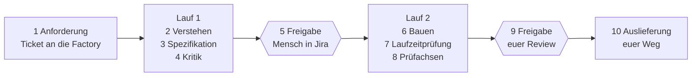

# Agent Factory bei Lekkerland: Blueprint

Workshop Agentic Engineering, 23. bis 25. November 2026, Frechen

Stand: 15. November 2026. Status: Entwurf.

Dieses Dokument zeigt, wie die Agent Factory eure zehn Schritte von „Anforderung“ bis „Auslieferung“ abdecken soll. Es bleibt bewusst kurz, denn vieles davon ist noch nicht getestet. Die Details klären wir am Dienstag, 24. November, in euren Repository-Kopien.

Die Agenda steht in `lekkerland-workshop-agenda.md`, die Checkliste in `lekkerland-checkliste.md`. Öffentliche Quellen haben eine Nummer in eckigen Klammern, etwa [1].

## Eure zehn Schritte in der Factory

Die Schritte und eure Einschätzung von heute stammen aus eurer Selbsteinschätzung im Workshop vom September 2026. Euer Ziel für Ende 2026 ist dort Stufe 3 „Kette“ in allen zehn Schritten.

| Euer Schritt | Heute (eure Einschätzung) | In der Factory (unser Vorschlag) | Wer | Stand |
|---|---|---|---|---|
| 1. Anforderung | Stufe 1, in Teilen | Ein Jira-Ticket mit Akzeptanzkriterien. Ein Mensch gibt es an die Factory; das startet Lauf 1 | Mensch | wie heute |
| 2. Verstehen | fehlt | **Lauf 1:** Der Agent liest Ticket und Code | Agent | Vortest |
| 3. Spezifikation | Stufe 1, in Teilen | **Lauf 1:** Der Agent schreibt die Spec nach dem gewählten Framework | Agent | Vortest |
| 4. Kritik | fehlt | **Lauf 1:** Die Factory prüft, ob die Spec vollständig ist und der Agent nur die Spec geändert hat. Die inhaltliche Kritik bleibt bei Freigabe 1. Ob ein zweiter Agent die Spec kritisieren soll, klären wir am Dienstag | Factory | Vorschlag |
| 5. Freigabe | fehlt | **Freigabe 1:** Ein Mensch aus der Freigabegruppe gibt die Spec in Jira frei. Das startet Lauf 2 | Mensch | Vorschlag |
| 6. Bauen | Stufe 2 | **Lauf 2:** Der Agent setzt die freigegebene Spec um | Agent | Vortest |
| 7. Laufzeitprüfung | fehlt | **Lauf 2:** Build und eure Tests laufen in einem eigenen Schritt, ohne Secrets | Factory | Vorschlag |
| 8. Prüfachsen | fehlt | **Lauf 2:** Schutzprüfungen der Factory, etwa ob geschützte Dateien unverändert sind. Welche Prüfachsen ihr selbst braucht, etwa statische Analyse oder Architekturregeln, klären wir am Dienstag | Factory | Vorschlag |
| 9. Freigabe | fehlt | **Freigabe 2:** euer Review des Pull Requests, nach dem Vier- oder Sechs-Augen-Prinzip | Mensch | wie heute |
| 10. Auslieferung | fehlt | Merge und euer bestehender Weg in Produktion. Die Factory liefert nicht selbst aus | Mensch | wie heute |

**Stand:** „Vortest“ heißt, dass der Schritt am 15. November auf dem Mac lief, an einer kleinen Beispielanwendung, mit offenen Punkten (siehe unten). „Vorschlag“ heißt, dass er noch nicht getestet ist.

**Stufe 3:** In den Schritten 2 bis 9 ist das unser Vorschlag für Stufe 3 „Kette“: Die Factory übernimmt sechs Schritte, und die zwei Freigaben bleiben Pflicht. Schritte 1 und 10 bleiben, wie sie heute sind. Ob die Factory Stufe 3 erreicht, bewertet ihr nach den ersten echten Tickets.

**SAP:** Für ABAP gilt das zunächst nur für die Schritte 1 bis 5. Bauen, Prüfen und Transport bleiben beim SAP-Team.

## Ablauf

So soll es funktionieren; getestet ist das noch nicht:

- Beide Läufe laufen in Bitbucket Pipelines. Copilot CLI arbeitet darin unbeaufsichtigt mit dem Framework, das ihr am Montag wählt: Spec Kit, OpenSpec oder BMad Method.
- Den Pull Request öffnet die Pipeline, nicht der Agent.
- Ändert sich Ticket oder Spec nach Freigabe 1, gilt die Freigabe nicht mehr; das Ticket geht zurück an Lauf 1. Findet Lauf 2 ein Problem in der Spec, stoppt er und gibt das Ticket an Menschen zurück.
- Jede Person im Pilot kann ein Ticket auf „Factory gestoppt“ setzen. Die Factory prüft das vor jedem Schritt, der etwas schreibt. Aufheben können den Stopp nur Menschen.

## Was der Vortest gezeigt hat

Am 15. November haben wir Spec Kit, OpenSpec und BMad über Copilot CLI laufen lassen, ohne Rückfragen, mit dem Modell Claude Sonnet 5.5. Testobjekt war eine kleine PHP-Beispielanwendung, nicht euer Code: je Framework ein kleines Feature und ein Bug. Einzelne Schritte liefen mehrfach. Die Specs entstanden auf dem Mac und in einem Linux-Container, die Umsetzung nur auf dem Mac.

- **Ohne Rückfragen geht es.** Alle drei Frameworks schrieben Spec und Code. Offen blieb dabei einiges: Spec Kit erledigte 12 von 13 Aufgaben, OpenSpec pausierte bei 5 von 6, und BMad lief erst durch, als es Commits machen durfte.
- **Die Factory muss selbst prüfen.** Der Exit-Code von Copilot CLI war auch dann 0, wenn Werkzeuge abgelehnt wurden oder ein Schritt pausierte.
- **Freigabe 1 bleibt nötig.** Zwei Läufe zum selben Ticket trafen unterschiedliche fachliche Annahmen.
- **Klare Vorgaben im Prompt.** Ohne genannten Testbefehl wählte das Modell immer wieder einen, der abgelehnt wurde. Bei BMad musste der Prompt außerdem verlangen, jedem Schritt des Ablaufs zu folgen.
- **Kosten:** 30 bis 120 AI Credits für ein kleines Feature, je nach Framework, also 0,30 bis 1,20 US-Dollar [1]. Das sind Einzelwerte aus je einem Lauf, kein Erwartungswert für euren Code. Die Kosten je Ticket messen wir im Workshop.

## Sicherheit: Grundsätze

Wir nehmen an, dass in Ticket-Text Prompt Injections stecken können und der Agent dann tut, was der Angreifer will. Die Factory soll den Schaden begrenzen. Das ist unser Design; getestet ist es noch nicht.

- **Der Agent hat keine Zugänge zu Jira** und auf Bitbucket nur Leserecht auf das Repository. Er hat aber den Copilot-Token und den Code. Wo das Netz offen ist, könnte er beides nach außen senden. Deshalb hat der Token nur das Recht „Copilot Requests“, läuft kurz und lässt sich sofort widerrufen.
- **Andere Secrets sieht der Agent nicht.** Was Jira und Bitbucket brauchen, liegt in Deployment-Variablen, die nur andere Schritte nutzen [2]. Workspace- und Repository-Variablen gehen dagegen an jeden Schritt; deshalb dürfen dort keine Secrets liegen.
- **Code, den der Agent schreibt, läuft nur in Schritten ohne Secrets.** Lauf 1 darf nur die Spec ändern. Lauf 2 nutzt die Spec nur als Eingabe.
- **Freigabe 1 können nur Menschen erteilen,** und sie gilt nur für genau den Stand der Spec, den die Factory zur Freigabe zeigt. Im Workshop sind alle Teilnehmenden Projekt-Admin in Jira und könnten das ändern. Technisch gilt die Beschränkung erst, wenn nur benannte Personen Admin sind.
- **`main` ist geschützt.** Bis 30. April 2027 bekommen Pipeline-Schritte ohne eigene Rechte-Angabe Schreibrechte [3]. Deshalb bekommt jeder Schritt ausdrücklich nur Leserecht, und nur benannte Menschen dürfen auf `main` pushen.
- **Copilot CLI läuft nie mit weitgehenden Optionen** wie `--allow-all` oder `--yolo` [4]. Die Pipeline prüft das vor jedem Start.
- **Im Zweifel stoppt die Factory,** statt zu pushen oder zu kommentieren.

## Was die Factory braucht

- **Copilot-Token:** im Workshop der Token einer teilnehmenden Person, gültig bis 4. Dezember. Danach der Token eines technischen GitHub-Benutzers, mit einem Budget, das bei Erreichen die Nutzung stoppt [1].
- **Jira-Konto der Factory:** ohne Admin-Rechte und nicht in der Freigabegruppe.
- **Bitbucket-Zugang der Factory:** darf Branches pushen und Pull Requests öffnen, nie auf `main`.
- **Jira-Automation:** startet die Läufe, je Gruppe für die eigene Repository-Kopie.

Die genauen Rechte und Einstellungen legen wir am Dienstag fest.

## Was noch offen ist

- Startet Jira-Automation die Läufe in Bitbucket Pipelines?
- Laufen Spec Kit, OpenSpec und BMad in der Pipeline, Schritt 2 bis 8?
- Können nur Menschen aus der Freigabegruppe Freigabe 1 erteilen? Gilt eine Freigabe nicht mehr, wenn sich die Spec danach ändert?
- Stoppt die Factory, wenn jemand während eines Laufs „Factory gestoppt“ setzt?
- Scheitern Angriffe wie diese: andere Secrets als den Copilot-Token auslesen, eine Freigabe fälschen, die Pipeline über den Agenten ändern?

## Quellen

Titel in Anführungszeichen sind Seitentitel.

1. GitHub Docs: „Usage-based billing for organizations and enterprises“, abgerufen am 09./10.11.2026 (1 AI Credit = 0,01 US-Dollar). https://docs.github.com/api/article/body?pathname=/en/copilot/concepts/billing-and-usage/organizations-and-enterprises/billing
2. Atlassian Support (Cloud): „Recommended practices for managing secret data in Bitbucket Pipelines“, aktualisiert am 26.09.2025. https://support.atlassian.com/bitbucket-cloud/kb/recommended-practices-for-managing-secret-data-in-bitbucket-pipelines/
3. Atlassian Support: „Step options“, abgerufen am 15.11.2026. https://support.atlassian.com/bitbucket-cloud/docs/steps
4. GitHub Docs: „GitHub Copilot CLI programmatic reference“, abgerufen am 15.11.2026. https://docs.github.com/en/copilot/reference/copilot-cli-reference/cli-programmatic-reference
