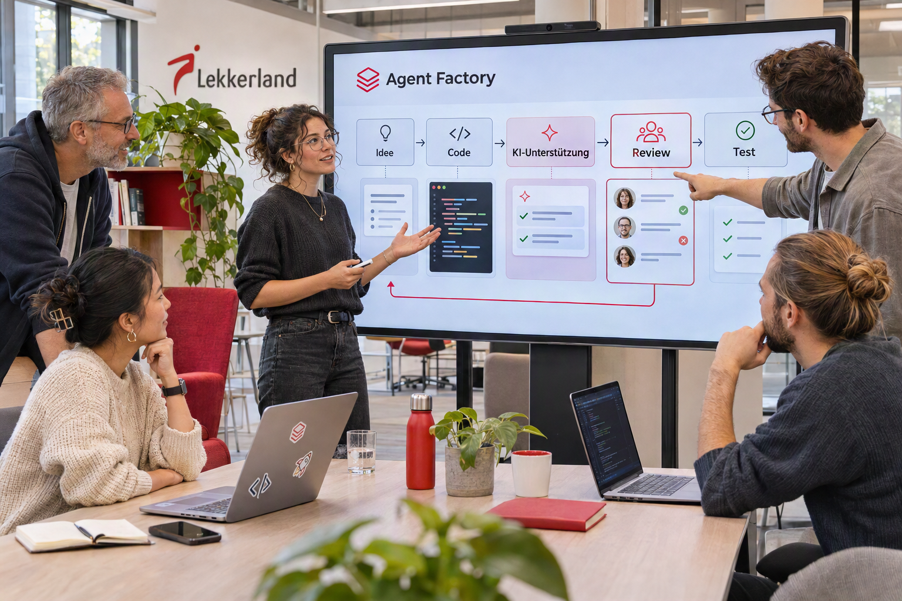

# Lekkerland startet die Agent Factory: Das Spryker-Team entwickelt mit KI-Agenten

**Frechen, 1. Januar 2027** – Lekkerland setzt KI in der Softwareentwicklung ab sofort nach gemeinsamen Standards ein. Als erstes Team arbeitet das Spryker-Team mit der neuen **Agent Factory**. Sie bündelt Regeln, Best Practices, Skills und automatisierte Qualitätsprüfungen in einem einheitlichen Ansatz. So entsteht eine verlässliche Grundlage, um KI sicher und effizient in der Softwareentwicklung einzusetzen.

Was bisher aus vielen einzelnen Experimenten bestand, wird damit zu einem gemeinsamen Vorgehen. Das Spryker-Team erprobt es als Pilot. Weitere Teams sollen folgen.

## Die Agent Factory: Anforderungen hinein, umsetzbare Lösungen heraus

Der Einstieg in die Agent Factory ist bewusst einfach: Anforderungen können unabhängig vom ursprünglichen Kanal aufgenommen werden.
Die Factory strukturiert und konkretisiert diese Anforderungen und erzeugt daraus einen Lösungsvorschlag, einen Prototyp oder eine umsetzbare Lösung. Wo Informationen fehlen oder fachliche Entscheidungen notwendig sind, fragt sie gezielt beim Menschen nach.
Die Agent Factory ersetzt damit nicht die Verantwortung des Menschen. Sie reduziert vielmehr die manuelle Arbeit zwischen einer guten Idee und einer funktionierenden Lösung.

## Mehr Zeit für Lösungen, weniger Zeit für Routine

KI-Agenten übernehmen im Spryker-Team wiederkehrende Aufgaben wie die Erstellung von Komponenten, Tests oder Refactorings. Dadurch gewinnen Entwicklerinnen und Entwickler mehr Zeit für die eigentlichen Herausforderungen: Architekturentscheidungen, fachliche Lösungen und die Weiterentwicklung der Anwendungen.

Auch die Zusammenarbeit mit den Fachbereichen wird einfacher und schneller. Anforderungen werden klar beschrieben und können deutlich zügiger umgesetzt werden. Erste Ergebnisse stehen oft bereits innerhalb weniger Tage zur Verfügung.

## Qualität und Sicherheit im Mittelpunkt

Ein zentraler Erfolgsfaktor der Agent Factory ist die transparente und nachvollziehbare Qualitätssicherung. Jede Änderung durchläuft automatisierte Prüfungen und definierte Freigabeschritte. Entscheidende Quality Gates bleiben bewusst menschlich: IT und Product Owner prüfen die Lösung, bevor sie die jeweils erforderlichen Freigabe- und Produktivsetzungsschritte durchläuft. Besonders bei sicherheitsrelevanten oder umfangreichen Anpassungen bleiben menschliche Entscheidungen ein fester Bestandteil des Prozesses.

Dabei gilt ein einfaches Prinzip: KI unterstützt, Menschen entscheiden.

## Erste Erfahrungen aus dem Pilot

In den vergangenen Wochen hat das Spryker-Team die Agent Factory erprobt. Standardaufgaben ließen sich deutlich schneller umsetzen, und die Qualität der Ergebnisse blieb hoch.

Eine wichtige Erkenntnis: Die größte Herausforderung liegt nicht in der Einführung der KI selbst, sondern in ihrer verlässlichen und nachvollziehbaren Nutzung. Deshalb setzt Lekkerland auf klare Leitplanken, gemeinsame Regeln und konsequente Qualitätsprüfungen.

## Wie es weitergeht

Nach dem Spryker-Team sollen weitere Teams an die Agent Factory angebunden werden: Frontend, Microservices, Plattform sowie SAP und Java.

Begleitet wird die Einführung durch ein zentrales Agent-Factory-Team, das die Plattform kontinuierlich weiterentwickelt. Zusätzlich unterstützen AI Champions in den einzelnen Teams dabei, Erfahrungen auszutauschen und erfolgreiche Vorgehensweisen gemeinsam weiterzuentwickeln. Auf diese Weise sollen alle Teams von gemeinsamen Standards, einer hohen Qualität und einem stetig wachsenden Wissensnetzwerk profitieren.

Die Agent Factory schafft damit die Grundlage, KI dauerhaft und verantwortungsvoll in die Softwareentwicklung zu integrieren und die Digitalisierung von Lekkerland weiter zu beschleunigen.
